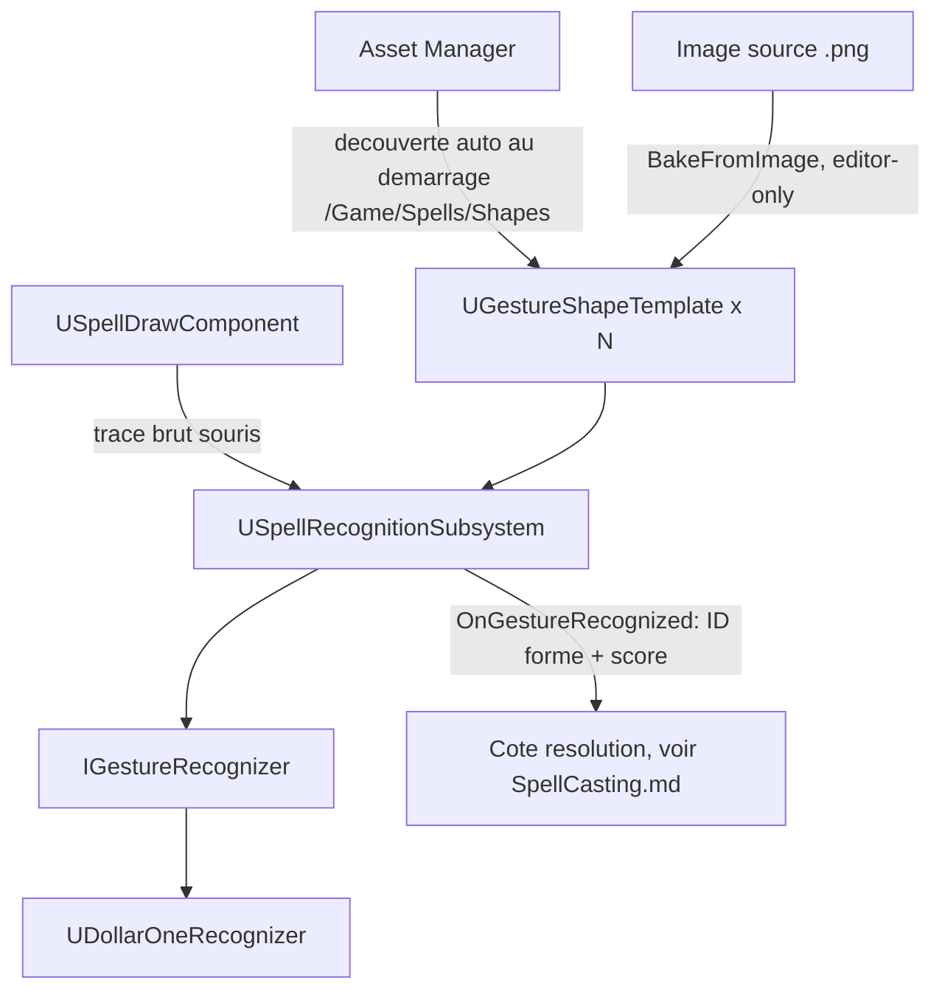

# Reconnaissance de formes (dessin de sorts)

Transforme un tracé souris en identifiant de forme reconnue (`FName` + score). Ne sait rien de ce
qu'est un sort — c'est la face "reconnaissance" de la frontière décrite dans `SpellCasting.md`.

**Statut** : implémenté (capture, algorithme, bibliothèque de formes)

## Pièces

| Fichier | Rôle | Notes |
|---|---|---|
| `SpellDrawComponent.h/.cpp` | Capture le tracé souris pendant le dessin | Redirige l'input caméra pendant le tracé ; ne connaît ni les sorts ni le buffer |
| `GestureRecognizer.h` | `IGestureRecognizer` (interface) + `FGestureTemplate`/`FGestureRecognitionResult` | Swappable : $1 aujourd'hui, $N multi-trait envisagé pour une Phase 2 (composition de formes) |
| `DollarOneRecognizer.h/.cpp` | Implémente l'algorithme $1 Unistroke (Wobbrock/Wilson/Li 2007) | Resample → rotation à l'angle indicatif → mise à l'échelle → recherche par section dorée |
| `GestureShapeTemplate.h/.cpp` | Data Asset d'une forme reconnaissable (`UPrimaryDataAsset`) | Image source + points normalisés bakés + `ShapeId` ; possède `BakeFromImage()` |
| `GestureShapeBatchGenerator.h/.cpp` | Outil éditeur : crée et bake automatiquement une forme par image pas encore associée | Voir `Doc/WORKFLOW.md` pour la procédure d'ajout d'une forme |
| `SpellRecognitionSubsystem.h/.cpp` | Point d'entrée unique (`GameInstanceSubsystem`) | Découvre toutes les `UGestureShapeTemplate` via l'Asset Manager au démarrage |
| `Spells/Tests/*.cpp` | Tests d'automation (`Mage.Spells...`) | Précision/invariance de rotation du $1, helpers de bake — pas de doc dédiée |

## USpellDrawComponent

- **Rôle** : capture le delta souris pendant le dessin, alimente `CurrentStroke` (espace de dessin
  local). Ne nettoie **pas** le tracé à la fin (`EndStroke`) mais au **début** du suivant
  (`BeginStroke`) — pour que `AMageHUD` puisse "rattraper" l'affichage retardé du tracé après la
  fin du dessin.
- **`ShouldSuppressCameraInput()`** : vraie pendant le dessin ET une courte fenêtre après
  (`PostStrokeGraceSeconds`) — absorbe le mouvement souris résiduel au relâchement, indépendamment
  de l'ordre d'évaluation entre les actions Draw et Look sur la même frame.
- **`CancelStroke()`** : interrompt un tracé sans tenter de le reconnaître (utilisé par le dash,
  voir `Character.md`) — ne déclenche jamais `OnGestureRecognized`.
- **Renvoi** : `OnGestureRecognized` est consommé par `USpellBufferComponent`, voir
  `SpellCasting.md`.

## UDollarOneRecognizer

- **Rôle** : implémentation concrète de `IGestureRecognizer`. `Normalize()` : Resample →
  `CanonicalizeWindingOrder` → rotation par `-IndicativeAngle` → `ScaleToSquare` →
  `TranslateToOrigin`. `Recognize()` : distance minimale (recherche par section dorée) contre
  chaque template chargé ; `RecognitionThresholdOverride` d'un template prime sur le seuil global.
- **Gotchas / bugs trouvés** (utile si on réimplémente ou qu'on change d'algorithme un jour) :
  - Un trait épais crée deux bords (intérieur/extérieur) que le tri "plus proche voisin" peut
    parcourir comme deux tours au lieu d'un → la taille de sous-échantillonnage (`GestureShapeTemplate::BakeFromImage`)
    est proportionnelle à la taille de la forme, pas fixe en pixels.
  - Le $1 n'est invariant qu'à la rotation/échelle, **pas** au sens de tracé (horaire/anti-horaire)
    — un joueur peut dessiner un cercle dans les deux sens → sens de parcours forcé
    systématiquement (aire signée du polygone) dans `Normalize()` via `CanonicalizeWindingOrder`.

## UGestureShapeTemplate / UGestureShapeBatchGenerator

- **Rôle** : `BakeFromImage()` (editor-only) lit les pixels d'encre d'une image source
  (luminance/alpha), les sous-échantillonne sur une grille (taille adaptative, voir gotcha
  ci-dessus), les ordonne en chemin (plus proche voisin, départ = point le plus haut puis le plus à
  gauche), puis normalise. `UGestureShapeBatchGenerator` scanne un dossier source et fait cette
  opération pour chaque image pas encore associée à une forme — voir `Doc/WORKFLOW.md`.
- **Pourquoi ça scale** : zéro ligne de code, zéro recompilation pour ajouter une forme —
  découverte automatique par l'Asset Manager (`Config/DefaultGame.ini`,
  `PrimaryAssetTypesToScan`). Les ID de formes sont des `FName` simples (pas de `GameplayTags` —
  jugé inutilement complexe à ce stade pour une poignée de formes).

## USpellRecognitionSubsystem

- **Rôle** : `GameInstanceSubsystem`, chargé une fois par session. Charge toutes les
  `UGestureShapeTemplate` via `UAssetManager::GetPrimaryAssetIdList`, les convertit en
  `FGestureTemplate` pour `IGestureRecognizer`. Précédent réutilisé pour
  `UElementReactionSubsystem` (voir `Elements.md`).

## Points ouverts

- **Faux positifs non résolus** : en jeu, certaines formes se font encore confondre avec Square
  plus souvent qu'attendu (déjà noté au niveau global dans le README). Hypothèse actuelle : le
  tracé souris capturé en direct est probablement sous-échantillonné (trop peu de points bruts
  pendant un tracé rapide), contrairement aux formes bakées qui partent d'images à haute
  résolution — pas encore vérifié avec de vraies données de capture. Un log de diagnostic existe
  déjà dans `USpellDrawComponent::EndStroke()` (longueur/nombre de points du tracé brut) pour
  investiguer ça au besoin.

## Renvois

- `OnGestureRecognized` → consommé par `USpellBufferComponent`, voir `SpellCasting.md`
- Affichage du tracé (croix de visée, ligne, mode monde 3D) → `AMageHUD`, voir `Character.md`
- Lien réseau (reconnaissance 100% côté client) → voir `SpellCasting.md`
