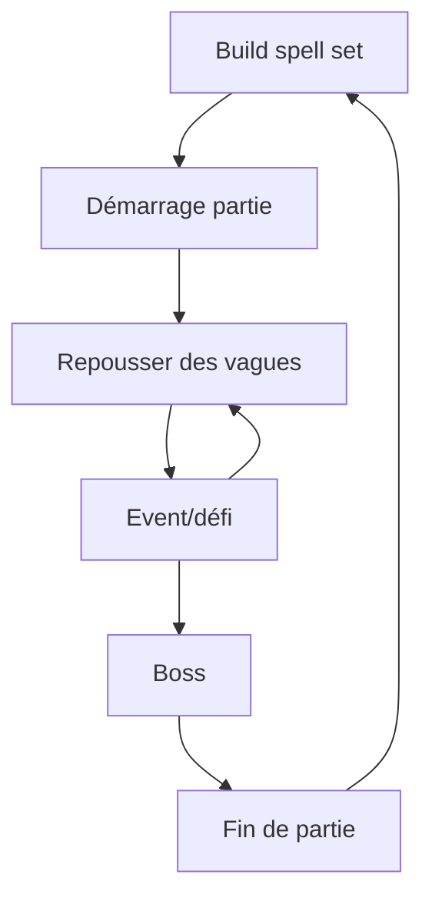

# Brainstorm Gameplay - [Nom du jeu]

## 1. Vision générale

### Pitch en une phrase

Décrire le jeu en une phrase simple :
- Un jeu d'action où le joueur dessine des formes magiques pour invoquer des pouvoirs en temps réel.

---

### Fantaisie du joueur

**Que doit ressentir le joueur ?**

- [ ] Puissance
- [ ] Maîtrise
- [ ] Exploration
- [x] Stress
- [x] Créativité
- [x] Coopération
- [x] Anticipation
- [ ] Progression
- [ ] Compétition
- [ ] Autre :

Notes :

---

### Références

Jeux similaires :

- Mage arena
- slay the spire
- battlerite
- megabonk

Ce qu'on aime :
- bagarre
- réactions en chaines
- préparation
- réflexion sur les build
- nombreuses combinaisons possibles
- combos
- intéractions entre les sorts                      
- variantes de sorts pendant la game (pas game breaker)
- pas deux games pareilles
- un bon joueur doit être gratifié par rapport à un débutant
- skillcap élévé
- sorts limités ig
- faiblesse selon les éléments
- sorts élémentaires
- revive 

Ce qu'on veut éviter :
- trop d'aléatoire
- pas de gros écarts de niveaux ig
- ne pas trop orienter l'expérience sur : celui qui dessine le mieux gagne


# 2. Boucle de gameplay principale

## Core Loop

Décrire l'action répétée par le joueur :



> Deux possibilités de gameplay :
>s
> * Mode attaque : ile en ile, il faut survivre pour arriver au bout de l'archipel, en choisissant successivement les chemins pour aller sur les iles, jusqu'à l'ile finale ou il y a un boss.
>
> * Mode défense : Point à défendre, vagues d'énemies à repousser, entre les vagues, événement en équipe, jusqu'au boss.


Lors du spell set build, le joueur peut sélectionner un nombre limité de sorts qui apparaitront dans sa partie aux niveaux qu'il souhaite, aux autres niveaux, le sort sera aléatoire.

Pour repousser les vagues les joueurs jouent en coopération en utilisant leurs sorts.

L'event est à 4 joueurs, il permet aux joueurs d'obtenir des améliorations sur leurs sorts


## Session type

Durée idéale d'une partie : 30min.

# 3. Contrôles et interactions

## Input joueur

Plateforme :

- [x] PC clavier/souris
- [ ] Manette
- [ ] Mobile tactile
- [ ] VR

Contrôles :

| Action      | Input           |
|-------------|-----------------|
| Déplacement | z, q, s, d      |
| dessin      | clique gauche   |
| spell cast  | a, e, r         |
| sauter      | espace          |
| tab         | liste des sorts avec dessin |
| courir      | maj             | 


# 4. Mécaniques principales

Explication mécaniques du jeux en détail.

## Mécanique #1 : Dessin de sorts

Description :

Le joueur trace une forme à la souris (clic gauche maintenu) pour lancer un sort. Le système est prévu pour évoluer en deux temps :

**Phase 1 (démo jouable)** — formes simples et fixes
- Chaque sort est associé à une forme géométrique simple (cercle, spirale, Z, etc.)
- Reconnaissance tolérante (pattern matching), pas besoin d'être pixel-perfect
- Objectif : valider rapidement que le concept "dessiner pour lancer un sort" est fun avant de complexifier

**Phase 2 (vision cible)** — composition de formes
- Un dessin devient une combinaison de plusieurs formes, chacune apportant une composante du sort (ex : un rond = catégorie "défensif", une seconde forme ajoutée = élément "feu")
- Objectif : démultiplier le nombre de sorts possibles à partir d'un vocabulaire de formes restreint, plutôt qu'un sort = une forme unique
- Alimente directement les objectifs "nombreuses combinaisons possibles" et "variantes de sorts pendant la game" (section 1)

### Mobilité pendant le dessin

- Le joueur garde sa liberté de déplacement pendant qu'il dessine
- La caméra se verrouille (lock) le temps du tracé, pour éviter que le mouvement de souris fasse partir la caméra dans tous les sens
- Le risque ne vient donc pas de l'immobilité, mais de la perte de contrôle de la caméra/visée pendant le tracé — à affiner une fois qu'on testera comment ça se ressent en jeu

### Échec de dessin

- Un dessin non reconnu n'inflige aucune pénalité (pas de cooldown déclenché)
- Le joueur peut retenter immédiatement
- Le risque du dessin raté vient donc surtout du temps perdu en combat (et de l'exposition induite par le lock caméra), pas d'une punition directe

### Points ouverts / à trancher plus tard
- Comment la Phase 2 s'intègre avec le spell set build (section 2) une fois les compositions possibles
- Comment gérer la visée/orientation d'un sort si la caméra est lock pendant le dessin
- Nombre de formes de base dans le vocabulaire visuel (pas trop pour rester lisible sous stress, mais assez pour la combinatoire)

## Mécanique #2 : [Nom]

Description :

# 5. Joueur contre monde

## Environnement

Définir env

## Obstacles

monstres/boss

## Ennemis / adversaires

| Ennemi | Comportement | Faiblesse |
|-|-|-|
| | | |

# 6. Progression

## Système de progression

Le joueur progresse grâce à :

- [x] Niveau
- [x] Sorts
- [ ] Équipement
- [ ] Déblocage de contenu
- [x] Expérience du joueur
- [ ] Autre

# 7. Difficulté

## Courbe de difficulté

Début : DUR
Milieu : BIEN DUR COMME ROMAIN AIME
Fin : impossible

## Ce qui rend le jeu difficile

- Obligation de rester ensemble
- Nombre d'ennemies 
- Résistance limitée du personnage
- Cooldown des sorts
- Dessiner les sorts sous la pression
- Arène fermée, fuite impossible

# 8. Récompenses

In game, le joueur est récompensé par :
- nouveaux sorts à chaque niveau
- améliorations de sorts à chaque event
- Découverte de combos en coop

En fin de game, types de récompenses :
- Cosmétiques
- Nouveaux sorts dispos à mettre dans le set

# 9. Roadmap

## Version #1

À implémenter :
- Personnage qui peut : 
  - se déplacer et sauter
  - lancer des sorts en dessinant
  - première map
  - 2 ennemis finis

# 10. Idées/Débats
Altérations des ennemis : Faire le shaking de cam de suivi de dessin quand le joueur est altéré 
Doigt qui brille qui envoie un trait style faisceau jusqu'à devant l'écran 
Sorts compliqués (multi traits) : CTRL + Clic Droit
Sort simple : Clic droit
---

# Environnement de développement

## Infos projet
- Moteur : Unreal Engine 5.8, installé via Epic Games Launcher à `C:\Program Files\Epic Games\UE_5.8`
- Module de code : `Mage` (voir `Source/Mage/`)
- Système d'input : Enhanced Input (déjà configuré par défaut dans `Config/DefaultEngine.ini` / `Config/DefaultInput.ini`)

## Ouvrir le projet
- Éditeur Unreal : double-clic sur `Mage.uproject`
- Code (VSCode) : ouvrir `Mage.code-workspace` (pas juste le dossier) — c'est ce fichier qui contient les tasks de build et les configs de debug/lancement

## Compiler le code
- **Éditeur déjà ouvert** (cas le plus fréquent en itérant) : dans l'éditeur, `Ctrl+Alt+F11` → compile via Live Coding. Rapide après le tout premier build.
- **Depuis VSCode**, éditeur fermé : `Ctrl+Shift+B` → choisir `MageEditor Win64 Development Build`
- **Compiler + lancer l'éditeur en un coup** depuis VSCode : onglet Run and Debug → `Launch MageEditor (Development)` → `F5`

⚠️ Ne pas builder depuis VSCode/terminal pendant que l'éditeur tourne avec Live Coding actif → erreur `Unable to build while Live Coding is active`. Fermer l'éditeur, ou utiliser `Ctrl+Alt+F11` à la place.

⚠️ La configuration **Debug** n'est pas disponible avec cette distribution du moteur (installée via le Launcher, binaires précompilés en Development uniquement) → utiliser **Development** (build normal) ou **DebugGame** (pour poser des breakpoints dans le code du jeu).

Le tout premier build après l'ajout d'une nouvelle classe (nouvelle `UCLASS`) est plus long (régénération du code de réflexion par Unreal Header Tool + link complet du module) — les builds suivants sont bien plus rapides.

## Régénérer les fichiers de projet VSCode
Si VSCode ne voit pas un nouveau fichier source ou perd l'IntelliSense :
```
"C:\Program Files\Epic Games\UE_5.8\Engine\Binaries\DotNET\UnrealBuildTool\UnrealBuildTool.exe" -projectfiles -vscode -project="D:\code\unreal\jeux\Mage\Mage.uproject" -game -engine
```
(ou clic droit sur `Mage.uproject` → *Generate Visual Studio Code project files*)

## Clavier AZERTY
Unreal identifie les touches clavier par leur position physique (référencée sur un layout QWERTY), pas par le caractère imprimé. Binder `W/A/S/D` dans un Input Mapping Context correspond donc automatiquement, physiquement, aux touches `Z/Q/S/D` sur un clavier AZERTY — pas besoin de bindings spécifiques.
