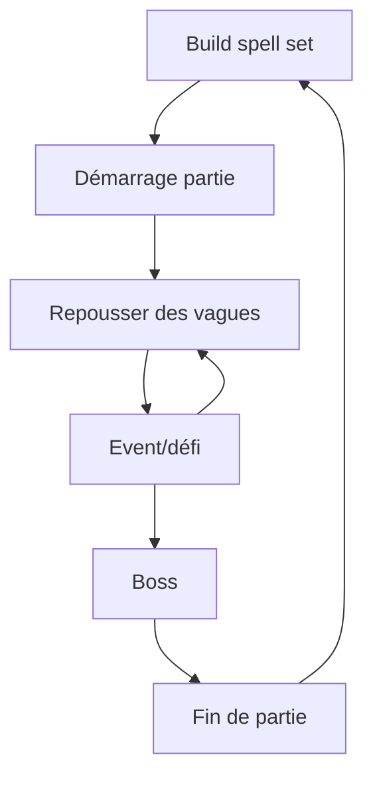

# Brainstorm Gameplay - Siglyph  

> Ce fichier garde la vision, les décisions de design et le statut d'implémentation. Pour les
> procédures pratiques ("comment j'ajoute un sort/élément/ennemi..."), voir `Doc/WORKFLOW.md`. Pour
> la référence technique détaillée, système par système, voir `Doc/Systems/README.md`.

## 1. Vision générale

### Pitch en une phrase

Décrire le jeu en une phrase simple :
- Un jeu d'action où le joueur dessine des formes magiques pour invoquer des pouvoirs en temps réel.

---

### Fantaisie du joueur

**Que doit ressentir le joueur ?**

- [ ] Puissance
- [ ] Maîtrise
- [ ] Exploration
- [x] Stress
- [x] Créativité
- [x] Coopération
- [x] Anticipation
- [ ] Progression
- [ ] Compétition
- [ ] Autre :

Notes :

---

### Références

Jeux similaires :

- Mage arena
- slay the spire
- battlerite
- megabonk

Ce qu'on aime :
- bagarre
- réactions en chaines
- préparation
- réflexion sur les build
- nombreuses combinaisons possibles
- combos
- intéractions entre les sorts                      
- variantes de sorts pendant la game (pas game breaker)
- pas deux games pareilles
- un bon joueur doit être gratifié par rapport à un débutant
- skillcap élévé
- sorts limités ig
- faiblesse selon les éléments
- sorts élémentaires
- revive 

Ce qu'on veut éviter :
- trop d'aléatoire
- pas de gros écarts de niveaux ig
- ne pas trop orienter l'expérience sur : celui qui dessine le mieux gagne


# 2. Boucle de gameplay principale

## Core Loop

Décrire l'action répétée par le joueur :



> Deux possibilités de gameplay :
>s
> * Mode attaque : ile en ile, il faut survivre pour arriver au bout de l'archipel, en choisissant successivement les chemins pour aller sur les iles, jusqu'à l'ile finale ou il y a un boss.
>
> * Mode défense : Point à défendre, vagues d'énemies à repousser, entre les vagues, événement en équipe, jusqu'au boss.


Lors du spell set build, le joueur peut sélectionner un nombre limité de sorts qui apparaitront dans sa partie aux niveaux qu'il souhaite, aux autres niveaux, le sort sera aléatoire.

Pour repousser les vagues les joueurs jouent en coopération en utilisant leurs sorts.

L'event est à 4 joueurs, il permet aux joueurs d'obtenir des améliorations sur leurs sorts


## Session type

Durée idéale d'une partie : 30min.

# 3. Contrôles et interactions

## Input joueur

Plateforme :

- [x] PC clavier/souris
- [ ] Manette
- [ ] Mobile tactile
- [ ] VR

Contrôles :

| Action      | Input           |
|-------------|-----------------|
| Déplacement | z, q, s, d      |
| dessin      | clique gauche   |
| spell cast  | a, e, r         |
| sauter      | espace          |
| tab         | liste des sorts avec dessin |
| courir      | maj             | 


# 4. Mécaniques principales

Explication mécaniques du jeux en détail.

## Mécanique #1 : Dessin de sorts

Description :

Le joueur trace une forme à la souris (clic gauche maintenu) pour **préparer** un sort — le dessin ne le lance pas directement. Le système est prévu pour évoluer en deux temps :

**Phase 1 (démo jouable)** — formes simples et fixes
- Chaque sort est associé à une forme géométrique simple (cercle, spirale, Z, etc.)
- Reconnaissance tolérante (pattern matching), pas besoin d'être pixel-perfect
- Objectif : valider rapidement que le concept "dessiner pour préparer un sort" est fun avant de complexifier

**Phase 2 (vision cible)** — composition de formes
- Un dessin devient une combinaison de plusieurs formes, chacune apportant une composante du sort (ex : un rond = catégorie "défensif", une seconde forme ajoutée = élément "feu")
- Objectif : démultiplier le nombre de sorts possibles à partir d'un vocabulaire de formes restreint, plutôt qu'un sort = une forme unique
- Alimente directement les objectifs "nombreuses combinaisons possibles" et "variantes de sorts pendant la game" (section 1)

### Préparation et déclenchement (buffer de sorts)

- Un dessin reconnu ne lance pas le sort : il le place dans une **banque de 3 emplacements** ("buffer")
- Le joueur déclenche un sort déjà préparé via une touche dédiée (voir section 3, `spell cast`), qui consomme l'emplacement correspondant
- **Buffer plein** : dessiner un 4e sort remplace automatiquement le plus ancien sort préparé (FIFO) — dessiner reste donc toujours possible, mais un sort préparé peut être perdu s'il n'est pas utilisé à temps
- **Cooldown** : il s'applique uniquement au cast (au moment où le sort est réellement déclenché), jamais à la préparation — dessiner est toujours libre, seul le fait de relancer un même sort trop vite est limité
- Effet de bord utile : puisque le cast est différé, la visée/orientation du sort se calcule au moment du cast, pas au moment du dessin — donc pas de conflit avec le lock caméra pendant le tracé (voir ci-dessous)

### Mobilité pendant le dessin

- Le joueur garde sa liberté de déplacement pendant qu'il dessine
- La caméra se verrouille (lock) le temps du tracé, pour éviter que le mouvement de souris fasse partir la caméra dans tous les sens
- Ce lock ne concerne que la préparation : la visée au cast (via la banque de sorts) se fait caméra déverrouillée, donc aucune perte de contrôle au moment de lancer réellement le sort
- Le risque ne vient donc pas de l'immobilité, mais de la perte de contrôle de la caméra pendant le tracé lui-même — à affiner une fois qu'on testera comment ça se ressent en jeu

### Échec de dessin

- Un dessin non reconnu n'inflige aucune pénalité (pas de cooldown déclenché)
- Le joueur peut retenter immédiatement
- Le risque du dessin raté vient donc surtout du temps perdu en combat (et de l'exposition induite par le lock caméra), pas d'une punition directe

### Points ouverts / à trancher plus tard
- Comment la Phase 2 s'intègre avec le spell set build (section 2) une fois les compositions possibles
- Que se passe-t-il si le joueur dessine un sort déjà présent dans le buffer (stack en double, ou refus/pas d'effet ?)
- Nombre de formes de base dans le vocabulaire visuel (pas trop pour rester lisible sous stress, mais assez pour la combinatoire)

## Mécanique #2 : Éléments et interactions

**Statut : implémenté** (framework élémentaire, sorts qui appliquent un élément, réactions, ennemi
de test, grab + lancer — voir `Source/Mage/Elements/`, `Source/Mage/Enemies/`, `Source/Mage/Grab/`)

Description :

Quatre éléments de base (Feu, Eau, Terre, Air). Un sort élémentaire n'inflige pas seulement des
dégâts : il **applique un statut élémentaire** à sa cible. Deux éléments différents qui se
rencontrent physiquement sur une même cible déclenchent une **réaction** — un résultat différent
des deux éléments d'origine. Objectif : que préparer ses sorts demande de vraiment réfléchir
("cet ennemi est brûlable, je le brûle, je le lance dans une flaque pour déclencher autre chose"),
pas juste viser juste.

### Modèle retenu : réaction au contact

Pas une combinaison au moment du dessin (voir Phase 2 de Mécanique #1, formes composées) — les deux
idées pourront coexister plus tard, mais seule celle-ci est conçue ici. Le statut élémentaire est
porté par l'acteur touché, pendant une durée limitée. Deux façons de le faire réagir :
- Toucher une même cible avec deux sorts d'éléments différents avant que le premier n'expire
- Utiliser le sort de manipulation (voir plus bas) pour physiquement amener un élément vers un
  autre

Puisque la réaction se joue à l'impact et pas à la préparation, elle reste compatible avec le
principe déjà établi du buffer : viser/déclencher se décide au moment du cast, pas du dessin.

### Table des sorts

Liste des sorts disponibles pour un mage :

Colonne "Forme" = le geste dessiné à la souris qui déclenche le sort (voir Mécanique #1). Seules
**Cercle**, **Carré** et **Triangle** existent aujourd'hui comme formes entraînées/reconnues (voir
`Content/Spells/Shapes/`) ; les 7 autres sont des propositions à dessiner/entraîner plus tard
(chantier séparé, voir `Doc/claude-plan.md`) — à ajuster librement si une forme se dessine mal ou se
confond trop avec une autre une fois testée (voir le point ouvert dans `Doc/Systems/GestureRecognition.md`
sur les confusions déjà observées).

Sorts offensifs :

| Sort         | Forme | Element   | Tageté/aoe | Imprêgne un ennemi | Toutes surfaces |  spreadable | Description|
|--------------|-------|-----------|------------|--------------------|-----------------|-|-|
| **Boule de feu**   | Cercle | Feu       | target     | Oui | Oui | vent | Sphère de feu subissant la gravité |
| **Mur de feu**     | Trait | Feu       | aoe        | Oui | Oui | vent | Mur de feu perpendiculaire à l'axe du joueur |
| **Boule d'eau**    | Spirale | Eau       | target     | Oui | Oui | Oui | Sphère d'eau subissant la gravité |
| **Flaque d'eau**   | Triangle | Eau       | aoe        | Oui | Oui | Oui | grosse flaque d'eau projectile qui se répand une fois qu'il touche le sol, ralenti les énemis |
| **Boule de terre** | Carré | Terre     | target     | Oui | Oui | Oui | Sphère de terre subissant la gravité |
| **Mur de terre**  | Crénelures | Terre     | aoe        | Non | Oui | Oui | Mur de feu perpendiculaire à l'axe du joueur (molette pour tourner le sort ?) |
| **Eclair**         | Zigzag | Foudre    | target     | Oui | Non | Oui | Sort rectiligne electrique dirigé vers l'endroit visé |
| **champ electrique** | Étoile | Foudre  | target     | Oui | Oui | Oui | projectile éléctrique qui se répand une fois qu'il touche le sol |
| **vent violent**     | Flèche | air     | aoe        | Non | Non | Oui | Cône de vent qui spread certains éléments et modifie les trajectoires des projectiles |
| **vent libération**  | Infini (∞) | air     | aoe        | Non | Non | Oui | Repousse tous les ennemis à proximité et applique les mêmes effets que vent violent mais de manière circulaire |

### Table des combinaisons (par sort)

Même principe que la Table des combinaisons ci-dessous, mais au niveau du sort plutôt que de
l'élément — deux sorts d'un même élément ne réagissent pas entre eux (juste un rafraîchissement de
durée, voir plus bas), donc seules les paires inter-éléments sont listées.

| Sort 1              | Sort 2               | Effet |
|---------------------|----------------------|-------|
| Boule de feu        | Boule d'eau          | brume + disparition des deux |
| Boule de feu        | Flaque d'eau         | brume + disparition boule de feu |
| Boule de feu        | Boule de terre       | roche incandescante + disparition des deux |
| Boule de feu        | Mur de terre         | roche incandescante + disparition boule de feu |
| Boule de feu        | Eclair               | foudre enflammée + trajectoire éclair, disparition boule de feu |
| Boule de feu        | champ electrique     | foudre enflammée dans une zone petite zone à l'atterrissage |
| Boule de feu        | vent violent         | Feu spread en cône dans le sens du vent |
| Boule de feu        | vent libération      | Feu spread en cône dans le sens du vent |
| Mur de feu          | Boule d'eau          | Brume + disparition boule d'eau |
| Mur de feu          | Flaque d'eau         | Brume énorme + disparition des deux |
| Mur de feu          | Boule de terre       | Boule incandescente + sol incandescent en petite zone à l'atterrissage |
| Mur de feu          | Mur de terre         | Mur incandescent |
| Mur de feu          | Eclair               | foudre enflammée + trajectoire éclair, aucune disparition |
| Mur de feu          | champ electrique     | foudre enflammée sur toute la surface au sol touché par le feu |
| Mur de feu          | vent violent         | propagation du feu en cone en suivant le vent |
| Mur de feu          | vent libération      | propagation du feu en cone en suivant le vent |
| Boule d'eau         | Boule de terre       | Boule de boue + sol boueux en petite zone à l'atterrissage |
| Boule d'eau         | Mur de terre         | zone de boue sur le mur de terre de la taille de la boule, disparition boule |
| Boule d'eau         | Eclair               | boule d'eau devient electrifiée (stun amélioré) et continue sa course, éclair disparait |
| Boule d'eau         | champ electrique     | eau électrifiée par terre (stun amélioré) |
| Boule d'eau         | vent violent         | Eau spread (gouttes) en cône dans le sens du vent |
| Boule d'eau         | vent libération      | Eau spread (gouttes) en cône dans le sens du vent |
| Flaque d'eau        | Boule de terre       | Boue à l'emplacement de la boule de terre |
| Flaque d'eau        | Mur de terre         | Mur de boue sur toute la surface au sol touché par l'eau |
| Flaque d'eau        | Eclair               | électrocute la flaque dans une zone petite zone à l'atterrissage (stun amélioré) |
| Flaque d'eau        | champ electrique     | électrocute sur la superposition des deux (stun amélioré) |
| Flaque d'eau        | vent violent         | spread en cône (la moitié du cône est dans le sol) |
| Flaque d'eau        | vent libération      | spread en cône (la moitié du cône est dans le sol) |
| Boule de terre      | Eclair               | éclair disparait, boule de terre continue sa course |
| Boule de terre      | champ electrique     | aucune interaction |
| Boule de terre      | vent violent         | éclats de roches spread en cône dans le sens du vent |
| Boule de terre      | vent libération      | éclats de roches spread en cône dans le sens du vent |
| Mur de terre        | Eclair               | aucune interaction |
| Mur de terre        | champ electrique     | aucune interaction |
| Mur de terre        | vent violent         | éclats de roches spread en cône dans le sens du vent |
| Mur de terre        | vent libération      | éclats de roches spread en cône dans le sens du vent |
| Eclair              | vent violent         | foudre spread en cônes (petits éclairs) dans le sens du vent |
| Eclair              | vent libération      | foudre spread en cônes (petits éclairs) dans le sens du vent |
| champ electrique    | vent violent         | foudre spread en cônes (petits éclairs, large distance) dans le sens du vent |
| champ electrique    | vent libération      | foudre spread en cônes (petits éclairs, large distance) dans le sens du vent |

Le vent, en plus de spread certains éléments, agit également sur la trajectoire des projectiles.

Sorts de déplacement :

| Sort         | Forme | Element   | Tageté/aoe | Imprêgne un ennemi | Toutes surfaces |  spreadable | Description|
|--------------|-------|-----------|------------|--------------------|-----------------|-|-|
| vent libération  | Infini (∞) | air     | aoe        | Non | Non | Oui | Repousse tous les ennemis à proximité |

### Table des combinaisons

| A     | B     | Résultat                 | Rôle visé |
|-------|-------|--------------------------|----|
| Feu   | Eau   | **Brume**                | gêne la visée/visibilité |
| Eau   | Terre | **Boue**                 | terrain qui ralentit |
| Feu   | Terre | **Roche incandescente**  | zone de dégâts continus |
| Feu   | Air   | **Spread feu**           | flammes attisées |
| Eau   | Air   | **Spread eau**           | gouttes d'eau |
| Terre | Air   | **Spread terre**         | éclats de roches |
| Foudre | Eau  | **Stun**                 | electrise l'eau, stun en cas contact   |
| Foudre | Feu  | **feu avec éclairs**     | Degats massifs avec multiplicateur |
| Foudre | Air  | **Spread éclair**        | petits éclairs longue portée |

Répartition volontaire entre dégâts/contrôle/terrain/debuff, pour que plusieurs styles de jeu
restent viables (objectif d'équilibre) — à ajuster une fois testé en jeu.
Certains éléments peuvent perdurer sur toutes les surfaces, exemple : feu sur le sol tiens quelque secondes pendant lesquels il peut réagir avec autre chose.

> Ajouter des buffs ?  
> Sorts puissants qui coutent plus cher que juste un cooldown ?  
> Sorts d'aura ?  

### Affinités élémentaires par type d'ennemi

Chaque type d'ennemi réagit différemment à chaque élément — donnée par type, pas de branchement
au cas par cas :
- **Normal** : durée de statut standard (ex : le gobelin prend feu facilement, durée normale)
- **Absorbent** : le statut dure nettement plus longtemps — un mauvais choix pour affaiblir cet
  ennemi directement, mais un excellent "réservoir" à saisir puis lancer ailleurs (ex : le golem
  d'argile imprègne l'eau et le feu)

### Sort de manipulation (grab + lancer)

Contrairement aux sorts dessinés, ce sort est **toujours disponible** (pas de dessin, pas de
buffer) : une touche pour saisir un ennemi à distance, une autre (ou le relâchement) pour le lancer
dans la direction visée. C'est l'outil qui transforme deux statuts posés séparément en une réaction
provoquée à volonté, et le sens de tout le reste du système ("je brûle X, je le jette sur Y").

### Ce qui reste volontairement simple dans cette première itération

- Les 6 combinaisons pointent vers un seul effet placeholder générique (visuel provisoire) plutôt
  que 6 mécaniques de gameplay distinctes — le but est de valider la boucle complète (appliquer,
  faire se rencontrer, réagir, saisir/lancer) avant de peaufiner chaque résultat individuellement
- Ennemi de test minimal : marche vers le joueur, pas de PV/combat, juste un profil élémentaire —
  pour pouvoir jouer la boucle en PIE, pas pour préfigurer le vrai roster d'ennemis (voir section 5)
- Pas de réplication réseau (rien dans le projet ne l'est encore à ce stade)

### Terrain de jeux dans la scène de base

Deux types d'acteurs de test coexistent dans le niveau, pas un seul :
- Plusieurs **mannequins statiques** (acteur immobile + mesh + `UElementalStatusComponent`, aucun
  code supplémentaire nécessaire une fois le composant construit) placés côte à côte, mesh teinté
  selon l'élément porté (`OnElementChanged` -> matériau dynamique) — pour voir une réaction se
  déclencher instantanément en lançant deux sorts différents à proximité, sans dépendre du
  mouvement ou du grab/lancer
- L'**ennemi de test qui marche**, pour tester spécifiquement la boucle grab -> porter -> lancer

Comme les mannequins statiques ne demandent aucune classe C++ dédiée (juste le composant + un
Blueprint), ils peuvent être construits et testés dès que `UElementalStatusComponent` existe —
avant même l'ennemi qui marche. Ordre de construction ajusté en conséquence ci-dessous.

### Architecture technique

Détail de comment c'est construit (fichiers, classes, décisions de design, bugs trouvés) : voir
`Doc/Systems/Elements.md` et `Doc/Systems/EnemiesAndGrab.md`.

**Point ouvert** : et si un résultat de réaction (Steam, Mud...) devenait lui-même un état qu'un
acteur peut porter et qui peut réagir à son tour (Steam + Ice → Water, par exemple) — un vrai graphe
d'états plutôt qu'un simple tableau de paires ? Impliquerait de remplacer `EElement` (enum C++ figé)
par une identité d'état extensible par contenu (façon `FName`, comme les ID de formes) pour les
états composés, sans recompiler à chaque nouvel état. Idée en réflexion, pas encore tranchée.

# 5. Joueur contre monde

## Environnement

Définir env

## Obstacles

monstres/boss

## Ennemis / adversaires

| Ennemi  | vitesse | PV        | Faiblesse | Resistance |
|---------|---------|-----------|-----------|------------|
| Gobelin | rapide  | Faible    | fonction couleur |  
| Gobelin | | |
| Gobelin | | |

# 6. Progression

## Système de progression

Le joueur progresse grâce à :

- [x] Niveau
- [x] Sorts
- [ ] Équipement
- [ ] Déblocage de contenu
- [x] Expérience du joueur
- [ ] Autre

# 7. Difficulté

## Courbe de difficulté

Début : DUR
Milieu : BIEN DUR COMME ROMAIN AIME
Fin : impossible

## Ce qui rend le jeu difficile

- Obligation de rester ensemble
- Nombre d'ennemies 
- Résistance limitée du personnage
- Cooldown des sorts
- Dessiner les sorts sous la pression
- Arène fermée, fuite impossible

# 8. Récompenses

In game, le joueur est récompensé par :
- nouveaux sorts à chaque niveau
- améliorations de sorts à chaque event
- Découverte de combos en coop

En fin de game, types de récompenses :
- Cosmétiques
- Nouveaux sorts dispos à mettre dans le set

# 9. Roadmap

## Version #1

À implémenter :
- Personnage qui peut : 
  - se déplacer et sauter
  - lancer des sorts en dessinant
  - première map
  - 2 ennemis finis

## Version #2

à implementer :
- un premier niveau finis
- possibilité de perdre ou de gagner
- ajout des HP 

Assets :
- effets des éléments : feu, terre, eau voir Table des combinaisons.
- terrain de base (herbe, château, motte de terre, botte de foin ect..)
- animations énnemis en fonction des affinités (brule, mouillé, terré)
- animation marche + mort

# 10. Idées/Débats
Altérations des ennemis : Faire le shaking de cam de suivi de dessin quand le joueur est altéré 
Doigt qui brille qui envoie un trait style faisceau jusqu'à devant l'écran 
Sorts compliqués (multi traits) : CTRL + Clic Droit
Sort simple : Clic droit

# 11. Ennemis

Cette section détaille les ennemis.
Pour l'instant les ennemis prennent le status de tous les éléments.
faiblesse en fonction du type d'enemi.
ennemi peut porter arme. 

## Gobelin cac

- épée/bouclier
- Faiblesse feu *2 dégat *2 duration.
- Resistance terre /2 degats /2 duration.

## Gobelin mage

- baton de magie
- Faiblesse feu *2 dégat *2 duration.
- Resistance terre /2 degats /2 duration.

---

# Architecture

## Personnage jouable

**Statut : implémenté**. Détail (caméra, input, GameMode) : voir `Doc/Systems/Character.md`.

## Reconnaissance de formes (dessin de sorts)

**Statut : implémenté** (capture, algorithme, bibliothèque de formes, buffer de sorts, cast).
Détail : voir `Doc/Systems/GestureRecognition.md` (capture/algorithme/bibliothèque de formes) et
`Doc/Systems/SpellCasting.md` (buffer, cast, effets).

**Point ouvert non résolu** : en jeu, certaines formes se font encore confondre avec Square plus souvent qu'attendu — voir `Doc/Systems/GestureRecognition.md` pour l'hypothèse actuelle et où se trouve le log de diagnostic.

---

# Environnement de développement

## Infos projet
- Moteur : Unreal Engine 5.8, installé via Epic Games Launcher à `C:\Program Files\Epic Games\UE_5.8`
- Module de code : `Mage` (voir `Source/Mage/`)
- Système d'input : Enhanced Input (déjà configuré par défaut dans `Config/DefaultEngine.ini` / `Config/DefaultInput.ini`)

## Ouvrir le projet
- Éditeur Unreal : double-clic sur `Mage.uproject`
- Code (VSCode) : ouvrir `Mage.code-workspace` (pas juste le dossier) — c'est ce fichier qui contient les tasks de build et les configs de debug/lancement

## Compiler le code
Quand utiliser Live Coding vs un rebuild complet : voir la note transversale en tête de
`Doc/WORKFLOW.md`. Mécanique pour déclencher chaque option :
- **Éditeur déjà ouvert**, Live Coding : dans l'éditeur, `Ctrl+Alt+F11`
- **Depuis VSCode**, éditeur fermé : `Ctrl+Shift+B` → choisir `MageEditor Win64 Development Build`
- **Compiler + lancer l'éditeur en un coup** depuis VSCode : onglet Run and Debug → `Launch MageEditor (Development)` → `F5`

⚠️ Ne pas builder depuis VSCode/terminal pendant que l'éditeur tourne avec Live Coding actif → erreur `Unable to build while Live Coding is active`. Fermer l'éditeur, ou utiliser `Ctrl+Alt+F11` à la place.

⚠️ La configuration **Debug** n'est pas disponible avec cette distribution du moteur (installée via le Launcher, binaires précompilés en Development uniquement) → utiliser **Development** (build normal) ou **DebugGame** (pour poser des breakpoints dans le code du jeu).

Le tout premier build après l'ajout d'une nouvelle classe (nouvelle `UCLASS`) est plus long (régénération du code de réflexion par Unreal Header Tool + link complet du module) — les builds suivants sont bien plus rapides.

## Régénérer les fichiers de projet VSCode
Si VSCode ne voit pas un nouveau fichier source ou perd l'IntelliSense :
```
"C:\Program Files\Epic Games\UE_5.8\Engine\Binaries\DotNET\UnrealBuildTool\UnrealBuildTool.exe" -projectfiles -vscode -project="D:\code\unreal\jeux\Mage\Mage.uproject" -game -engine
```
(ou clic droit sur `Mage.uproject` → *Generate Visual Studio Code project files*)

## Clavier AZERTY
Unreal identifie les touches clavier par leur position physique (référencée sur un layout QWERTY), pas par le caractère imprimé. Binder `W/A/S/D` dans un Input Mapping Context correspond donc automatiquement, physiquement, aux touches `Z/Q/S/D` sur un clavier AZERTY — pas besoin de bindings spécifiques.