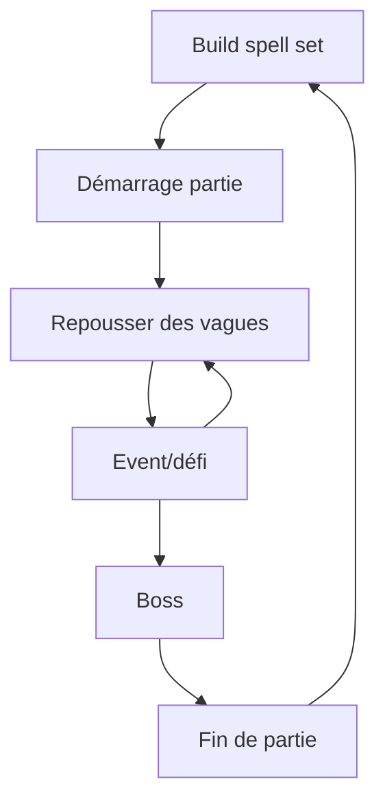
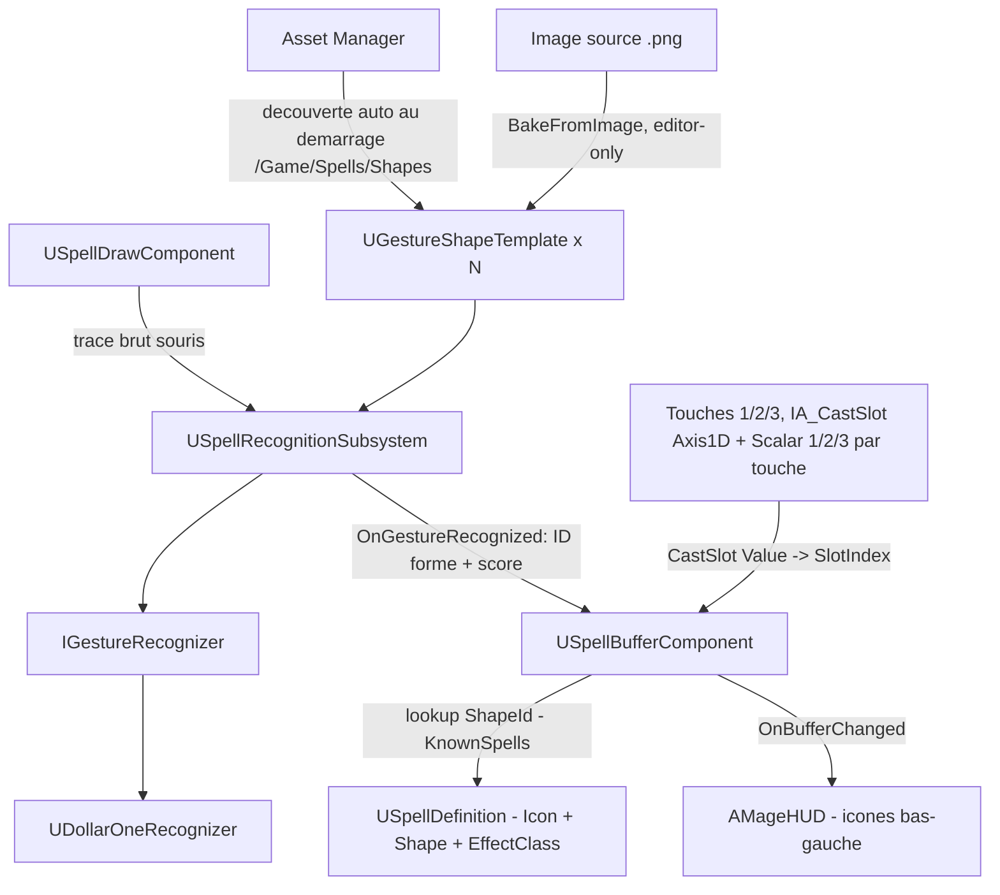

# Brainstorm Gameplay - [Nom du jeu]

## 1. Vision générale

### Pitch en une phrase

Décrire le jeu en une phrase simple :
- Un jeu d'action où le joueur dessine des formes magiques pour invoquer des pouvoirs en temps réel.

---

### Fantaisie du joueur

**Que doit ressentir le joueur ?**

- [ ] Puissance
- [ ] Maîtrise
- [ ] Exploration
- [x] Stress
- [x] Créativité
- [x] Coopération
- [x] Anticipation
- [ ] Progression
- [ ] Compétition
- [ ] Autre :

Notes :

---

### Références

Jeux similaires :

- Mage arena
- slay the spire
- battlerite
- megabonk

Ce qu'on aime :
- bagarre
- réactions en chaines
- préparation
- réflexion sur les build
- nombreuses combinaisons possibles
- combos
- intéractions entre les sorts                      
- variantes de sorts pendant la game (pas game breaker)
- pas deux games pareilles
- un bon joueur doit être gratifié par rapport à un débutant
- skillcap élévé
- sorts limités ig
- faiblesse selon les éléments
- sorts élémentaires
- revive 

Ce qu'on veut éviter :
- trop d'aléatoire
- pas de gros écarts de niveaux ig
- ne pas trop orienter l'expérience sur : celui qui dessine le mieux gagne


# 2. Boucle de gameplay principale

## Core Loop

Décrire l'action répétée par le joueur :



> Deux possibilités de gameplay :
>s
> * Mode attaque : ile en ile, il faut survivre pour arriver au bout de l'archipel, en choisissant successivement les chemins pour aller sur les iles, jusqu'à l'ile finale ou il y a un boss.
>
> * Mode défense : Point à défendre, vagues d'énemies à repousser, entre les vagues, événement en équipe, jusqu'au boss.


Lors du spell set build, le joueur peut sélectionner un nombre limité de sorts qui apparaitront dans sa partie aux niveaux qu'il souhaite, aux autres niveaux, le sort sera aléatoire.

Pour repousser les vagues les joueurs jouent en coopération en utilisant leurs sorts.

L'event est à 4 joueurs, il permet aux joueurs d'obtenir des améliorations sur leurs sorts


## Session type

Durée idéale d'une partie : 30min.

# 3. Contrôles et interactions

## Input joueur

Plateforme :

- [x] PC clavier/souris
- [ ] Manette
- [ ] Mobile tactile
- [ ] VR

Contrôles :

| Action      | Input           |
|-------------|-----------------|
| Déplacement | z, q, s, d      |
| dessin      | clique gauche   |
| spell cast  | a, e, r         |
| sauter      | espace          |
| tab         | liste des sorts avec dessin |
| courir      | maj             | 


# 4. Mécaniques principales

Explication mécaniques du jeux en détail.

## Mécanique #1 : Dessin de sorts

Description :

Le joueur trace une forme à la souris (clic gauche maintenu) pour **préparer** un sort — le dessin ne le lance pas directement. Le système est prévu pour évoluer en deux temps :

**Phase 1 (démo jouable)** — formes simples et fixes
- Chaque sort est associé à une forme géométrique simple (cercle, spirale, Z, etc.)
- Reconnaissance tolérante (pattern matching), pas besoin d'être pixel-perfect
- Objectif : valider rapidement que le concept "dessiner pour préparer un sort" est fun avant de complexifier

**Phase 2 (vision cible)** — composition de formes
- Un dessin devient une combinaison de plusieurs formes, chacune apportant une composante du sort (ex : un rond = catégorie "défensif", une seconde forme ajoutée = élément "feu")
- Objectif : démultiplier le nombre de sorts possibles à partir d'un vocabulaire de formes restreint, plutôt qu'un sort = une forme unique
- Alimente directement les objectifs "nombreuses combinaisons possibles" et "variantes de sorts pendant la game" (section 1)

### Préparation et déclenchement (buffer de sorts)

- Un dessin reconnu ne lance pas le sort : il le place dans une **banque de 3 emplacements** ("buffer")
- Le joueur déclenche un sort déjà préparé via une touche dédiée (voir section 3, `spell cast`), qui consomme l'emplacement correspondant
- **Buffer plein** : dessiner un 4e sort remplace automatiquement le plus ancien sort préparé (FIFO) — dessiner reste donc toujours possible, mais un sort préparé peut être perdu s'il n'est pas utilisé à temps
- **Cooldown** : il s'applique uniquement au cast (au moment où le sort est réellement déclenché), jamais à la préparation — dessiner est toujours libre, seul le fait de relancer un même sort trop vite est limité
- Effet de bord utile : puisque le cast est différé, la visée/orientation du sort se calcule au moment du cast, pas au moment du dessin — donc pas de conflit avec le lock caméra pendant le tracé (voir ci-dessous)

### Mobilité pendant le dessin

- Le joueur garde sa liberté de déplacement pendant qu'il dessine
- La caméra se verrouille (lock) le temps du tracé, pour éviter que le mouvement de souris fasse partir la caméra dans tous les sens
- Ce lock ne concerne que la préparation : la visée au cast (via la banque de sorts) se fait caméra déverrouillée, donc aucune perte de contrôle au moment de lancer réellement le sort
- Le risque ne vient donc pas de l'immobilité, mais de la perte de contrôle de la caméra pendant le tracé lui-même — à affiner une fois qu'on testera comment ça se ressent en jeu

### Échec de dessin

- Un dessin non reconnu n'inflige aucune pénalité (pas de cooldown déclenché)
- Le joueur peut retenter immédiatement
- Le risque du dessin raté vient donc surtout du temps perdu en combat (et de l'exposition induite par le lock caméra), pas d'une punition directe

### Points ouverts / à trancher plus tard
- Comment la Phase 2 s'intègre avec le spell set build (section 2) une fois les compositions possibles
- Que se passe-t-il si le joueur dessine un sort déjà présent dans le buffer (stack en double, ou refus/pas d'effet ?)
- Nombre de formes de base dans le vocabulaire visuel (pas trop pour rester lisible sous stress, mais assez pour la combinatoire)

## Mécanique #2 : [Nom]

Description :

# 5. Joueur contre monde

## Environnement

Définir env

## Obstacles

monstres/boss

## Ennemis / adversaires

| Ennemi | Comportement | Faiblesse |
|-|-|-|
| | | |

# 6. Progression

## Système de progression

Le joueur progresse grâce à :

- [x] Niveau
- [x] Sorts
- [ ] Équipement
- [ ] Déblocage de contenu
- [x] Expérience du joueur
- [ ] Autre

# 7. Difficulté

## Courbe de difficulté

Début : DUR
Milieu : BIEN DUR COMME ROMAIN AIME
Fin : impossible

## Ce qui rend le jeu difficile

- Obligation de rester ensemble
- Nombre d'ennemies 
- Résistance limitée du personnage
- Cooldown des sorts
- Dessiner les sorts sous la pression
- Arène fermée, fuite impossible

# 8. Récompenses

In game, le joueur est récompensé par :
- nouveaux sorts à chaque niveau
- améliorations de sorts à chaque event
- Découverte de combos en coop

En fin de game, types de récompenses :
- Cosmétiques
- Nouveaux sorts dispos à mettre dans le set

# 9. Roadmap

## Version #1

À implémenter :
- Personnage qui peut : 
  - se déplacer et sauter
  - lancer des sorts en dessinant
  - première map
  - 2 ennemis finis

# 10. Idées/Débats
Altérations des ennemis : Faire le shaking de cam de suivi de dessin quand le joueur est altéré 
Doigt qui brille qui envoie un trait style faisceau jusqu'à devant l'écran 
Sorts compliqués (multi traits) : CTRL + Clic Droit
Sort simple : Clic droit
---

# Architecture

## Personnage jouable

**Statut : implémenté** (voir `Source/Mage/MageCharacter.h/.cpp`)

`AMageCharacter` hérite de `ACharacter` (plutôt que d'un `APawn` brut) pour bénéficier gratuitement de la gestion du sol, de la gravité, du saut et de la réplication réseau native via `CharacterMovementComponent` — un point qui sert directement l'objectif "prêt pour la coop" (voir plus bas).

**Vue première personne**
- Caméra attachée directement à la capsule (pas de spring arm), positionnée à `BaseEyeHeight`
- `bUseControllerRotationYaw = true` (le corps suit le regard), Pitch/Roll laissés au contrôleur seul
- `CharacterMovementComponent::bOrientRotationToMovement = false` (pas d'auto-orientation vers le déplacement, comportement standard FPS)

**Déplacement, regard, saut**
- Enhanced Input : 3 Input Actions (`IA_Move` Axis2D, `IA_Look` Axis2D, `IA_Jump` Digital) + 1 Input Mapping Context (`IMC_Default`)
- Assignés sur le Blueprint enfant `BP_MageCharacter` (Class Defaults > Input)
- ⚠️ Les bindings clavier doivent être dans **Default Key Mappings**, pas dans **Mapping Profile Overrides** (réservé à des profils de rebinding alternatifs, jamais actifs par défaut — piège rencontré pendant le setup)
- Clavier AZERTY : voir la note dans "Environnement de développement" ci-dessous

**Mesh placeholder**
- Capsule du moteur (`/Engine/BasicShapes/Capsule`), en attendant un vrai personnage
- Cachée pour le propriétaire (`SetOwnerNoSee`) pour ne pas gêner la vue FPS — mais reste visible pour les autres joueurs en coop

**GameMode**
- `BP_MageGameMode` (parent `GameModeBase`) avec `Default Pawn Class = BP_MageCharacter`
- Réglé comme `GlobalDefaultGameMode` dans `Config/DefaultEngine.ini`
- Niveau de test : `Content/Maps/Default/DefaultMap.umap`

## Reconnaissance de formes (dessin de sorts)

**Statut : implémenté** (capture, algorithme, bibliothèque de formes, buffer de sorts, cast)



**Principe directeur** : la reconnaissance ne doit jamais savoir ce qu'est un sort, et le gameplay ne doit jamais savoir comment une forme est reconnue. Tant que cette frontière tient, chaque côté évolue indépendamment (nouvel algo, nouvelles formes, règles de composition Phase 2) sans onde de choc sur le reste.

**Les couches**

| Couche | Rôle | Composant |
|---|---|---|
| Capture | Échantillonne le tracé souris pendant le dessin (redirige l'input caméra) | `USpellDrawComponent` |
| Affichage | Croix de visée + ligne du tracé en cours, purement visuel | `AMageHUD` |
| Reconnaissance | Point d'entrée unique, chargé une fois par session (`GameInstanceSubsystem`) | `USpellRecognitionSubsystem` |
| Algorithme | Interface abstraite, swappable ($1 aujourd'hui, $N multi-trait pour la Phase 2) | `IGestureRecognizer` → `UDollarOneRecognizer` |
| Bibliothèque de formes | Data Assets découverts automatiquement (Asset Manager, `/Game/Spells/Shapes`) | `UGestureShapeTemplate` |
| Bake | Image → pixels d'encre → sous-échantillonnage → tri en chemin → normalisation | `UGestureShapeTemplate::BakeFromImage()` |
| Génération en lot | Crée et bake automatiquement une forme par image pas encore associée | `UGestureShapeBatchGenerator` |
| Résolution | Buffer de sorts (FIFO, 3 emplacements ajustables), lookup forme → sort, cast via touche dédiée | `USpellBufferComponent` / `USpellDefinition` |

**Pourquoi ça scale** : ajouter une forme = déposer une image dans `Content/Spells/Shapes/SourceImages/`, cliquer le bouton de génération en lot — zéro ligne de code, zéro recompilation, découverte automatique par l'Asset Manager. Les ID de formes sont des `FName` simples (pas de GameplayTags — jugé inutilement complexe à ce stade pour une poignée de formes).

**Deux limites de l'algorithme $1 découvertes et corrigées en pratique** (utile si on réimplémente ou qu'on en change un jour) :
- Un trait épais crée deux bords (intérieur/extérieur) que le tri "plus proche voisin" peut parcourir comme deux tours au lieu d'un → taille de sous-échantillonnage proportionnelle à la taille de la forme, pas fixe en pixels
- $1 n'est invariant qu'à la rotation/échelle, **pas** au sens de tracé (horaire/anti-horaire) — un joueur peut dessiner un cercle dans les deux sens → sens de parcours forcé systématiquement (aire signée du polygone) dans `Normalize()`

**Point ouvert non résolu** : en jeu, certaines formes se font encore confondre avec Square plus souvent qu'attendu. Hypothèse actuelle : le tracé souris capturé en direct est probablement sous-échantillonné (trop peu de points bruts pendant un tracé rapide), contrairement aux formes bakées qui partent d'images à haute résolution — pas encore vérifié avec de vraies données de capture.

**Cast des emplacements du buffer (touches 1/2/3)** : une seule Input Action (`IA_CastSlot`, Axis1D/float) sert les 3 touches, plutôt que 3 Input Actions distinctes — chaque touche porte son propre modificateur *Scalar* (1.0 / 2.0 / 3.0) dans l'IMC, ce qui permet de retrouver l'emplacement visé à partir de la seule valeur reçue côté C++ (`AMageCharacter::CastSlot`). Avantage direct : augmenter `MaxBufferSize` au-delà de 3 ne demande qu'une touche de plus dans l'IMC (Scalar 4.0), aucune recompilation.

**Lien réseau** : la reconnaissance reste 100% côté client (pas de réplication du tracé brut) ; seule la couche de résolution enverra plus tard une requête au serveur ("je veux lancer le sort X"), qui valide et exécute — cohérent avec le principe "client demande, serveur décide" retenu pour la coop.

---

# Environnement de développement

## Infos projet
- Moteur : Unreal Engine 5.8, installé via Epic Games Launcher à `C:\Program Files\Epic Games\UE_5.8`
- Module de code : `Mage` (voir `Source/Mage/`)
- Système d'input : Enhanced Input (déjà configuré par défaut dans `Config/DefaultEngine.ini` / `Config/DefaultInput.ini`)

## Ouvrir le projet
- Éditeur Unreal : double-clic sur `Mage.uproject`
- Code (VSCode) : ouvrir `Mage.code-workspace` (pas juste le dossier) — c'est ce fichier qui contient les tasks de build et les configs de debug/lancement

## Compiler le code
- **Éditeur déjà ouvert** (cas le plus fréquent en itérant) : dans l'éditeur, `Ctrl+Alt+F11` → compile via Live Coding. Rapide après le tout premier build.
- **Depuis VSCode**, éditeur fermé : `Ctrl+Shift+B` → choisir `MageEditor Win64 Development Build`
- **Compiler + lancer l'éditeur en un coup** depuis VSCode : onglet Run and Debug → `Launch MageEditor (Development)` → `F5`

⚠️ Ne pas builder depuis VSCode/terminal pendant que l'éditeur tourne avec Live Coding actif → erreur `Unable to build while Live Coding is active`. Fermer l'éditeur, ou utiliser `Ctrl+Alt+F11` à la place.

⚠️ La configuration **Debug** n'est pas disponible avec cette distribution du moteur (installée via le Launcher, binaires précompilés en Development uniquement) → utiliser **Development** (build normal) ou **DebugGame** (pour poser des breakpoints dans le code du jeu).

Le tout premier build après l'ajout d'une nouvelle classe (nouvelle `UCLASS`) est plus long (régénération du code de réflexion par Unreal Header Tool + link complet du module) — les builds suivants sont bien plus rapides.

## Régénérer les fichiers de projet VSCode
Si VSCode ne voit pas un nouveau fichier source ou perd l'IntelliSense :
```
"C:\Program Files\Epic Games\UE_5.8\Engine\Binaries\DotNET\UnrealBuildTool\UnrealBuildTool.exe" -projectfiles -vscode -project="D:\code\unreal\jeux\Mage\Mage.uproject" -game -engine
```
(ou clic droit sur `Mage.uproject` → *Generate Visual Studio Code project files*)

## Clavier AZERTY
Unreal identifie les touches clavier par leur position physique (référencée sur un layout QWERTY), pas par le caractère imprimé. Binder `W/A/S/D` dans un Input Mapping Context correspond donc automatiquement, physiquement, aux touches `Z/Q/S/D` sur un clavier AZERTY — pas besoin de bindings spécifiques.