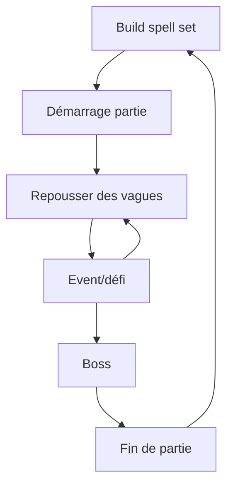

# Brainstorm Gameplay - [Nom du jeu]

## 1. Vision générale

### Pitch en une phrase

Décrire le jeu en une phrase simple :
- Un jeu d'action où le joueur dessine des formes magiques pour invoquer des pouvoirs en temps réel.

---

### Fantaisie du joueur

**Que doit ressentir le joueur ?**

- [ ] Puissance
- [ ] Maîtrise
- [ ] Exploration
- [x] Stress
- [x] Créativité
- [x] Coopération
- [x] Anticipation
- [ ] Progression
- [ ] Compétition
- [ ] Autre :

Notes :

---

### Références

Jeux similaires :

- Mage arena
- slay the spire
- battlerite
- megabonk

Ce qu'on aime :
- bagarre
- réactions en chaines
- préparation
- réflexion sur les build
- nombreuses combinaisons possibles
- combos
- intéractions entre les sorts                      
- variantes de sorts pendant la game (pas game breaker)
- pas deux games pareilles
- un bon joueur doit être gratifié par rapport à un débutant
- skillcap élévé
- sorts limités ig
- faiblesse selon les éléments
- sorts élémentaires
- revive 

Ce qu'on veut éviter :
- trop d'aléatoire
- pas de gros écarts de niveaux ig
- ne pas trop orienter l'expérience sur : celui qui dessine le mieux gagne

# 2. Boucle de gameplay principale

## Core Loop

Décrire l'action répétée par le joueur :

> Deux possibilités de gameplay :
>s
> * Mode attaque : ile en ile, il faut survivre pour arriver au bout de l'archipel, en choisissant successivement les chemins pour aller sur les iles, jusqu'à l'ile finale ou il y a un boss.
>
> * Mode défense : Point à défendre, vagues d'énemies à repousser, entre les vagues, événement en équipe, jusqu'au boss.

Lors du spell set build, le joueur peut sélectionner un nombre limité de sorts qui apparaitront dans sa partie aux niveaux qu'il souhaite, aux autres niveaux, le sort sera aléatoire.

Pour repousser les vagues les joueurs jouent en coopération en utilisant leurs sorts.

L'event est à 4 joueurs, il permet aux joueurs d'obtenir des améliorations sur leurs sorts

## Session type

Durée idéale d'une partie : 30min.

# 3. Contrôles et interactions

## Input joueur

Plateforme :

- [x] PC clavier/souris
- [ ] Manette
- [ ] Mobile tactile
- [ ] VR

Contrôles :

| Action      | Input           |
|-------------|-----------------|
| Déplacement | z, q, s, d      |
| dessin      | clique gauche   |
| spell cast  | a, e, r         |
| sauter      | espace          |
| tab         | liste des sorts avec dessin |
| courir      | maj             | 

# 4. Mécaniques principales

Explication mécaniques du jeux en détail.

## Mécanique #1 : [Nom]

Description :

## Mécanique #2 : [Nom]

Description :

# 5. Joueur contre monde

## Environnement

Définir env

## Obstacles

monstres/boss

## Ennemis / adversaires

| Ennemi | Comportement | Faiblesse |
|-|-|-|
| | | |

# 6. Progression

## Système de progression

Le joueur progresse grâce à :

- [x] Niveau
- [x] Sorts
- [ ] Équipement
- [ ] Déblocage de contenu
- [x] Expérience du joueur
- [ ] Autre

# 7. Difficulté

## Courbe de difficulté

Début : DUR
Milieu : BIEN DUR COMME ROMAIN AIME
Fin : impossible

## Ce qui rend le jeu difficile

- Obligation de rester ensemble
- Nombre d'ennemies 
- Résistance limitée du personnage
- Cooldown des sorts
- Dessiner les sorts sous la pression
- Arène fermée, fuite impossible

# 8. Récompenses

In game, le joueur est récompensé par :
- nouveaux sorts à chaque niveau
- améliorations de sorts à chaque event
- Découverte de combos en coop

En fin de game, types de récompenses :
- Cosmétiques
- Nouveaux sorts dispos à mettre dans le set

# 9. Roadmap

## Version #1

À implémenter :
- Personnage qui peut : 
  - se déplacer et sauter
  - lancer des sorts en dessinant
  - première map
  - 2 ennemis finis
